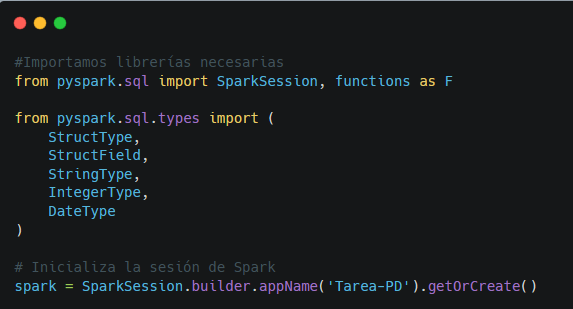
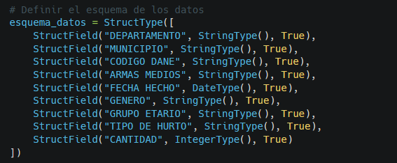
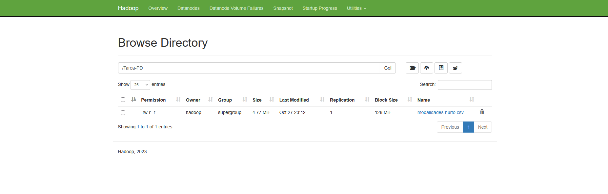
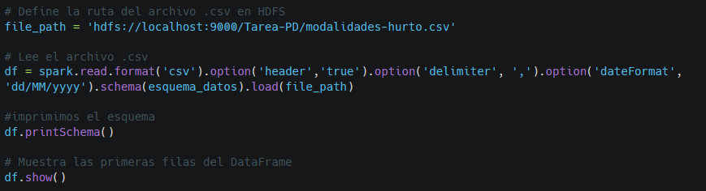
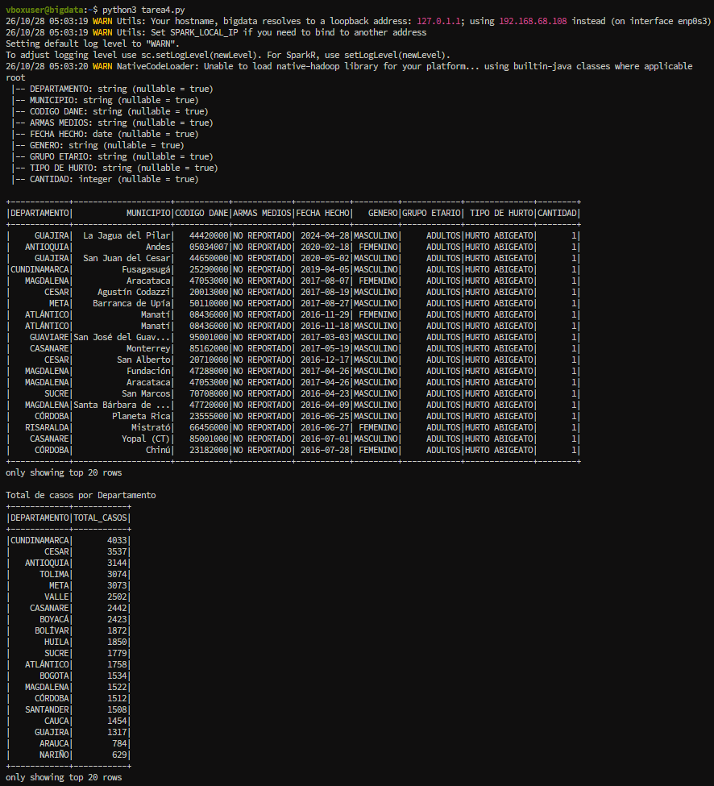
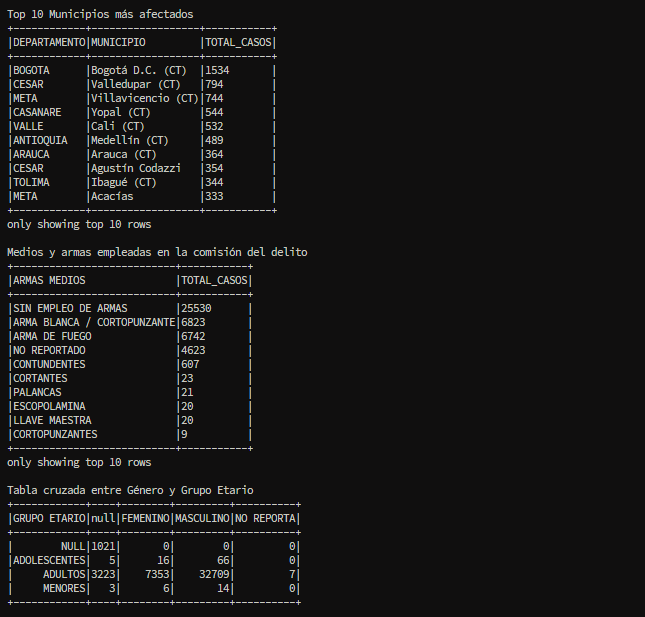

# Tarea 3 - Procesamiento de Datos con Apache Spark

## Estudiante: **Ana Lucia Ortiz Gutierrez**
## Grupo: **202016911_32**
## Curso: **Big Data**

## Objetivo:
Desarrollar una aplicación implementado Spark (utilizando Python) que realicen las siguientes tareas:
- Cargar el conjunto de datos seleccionado desde la fuente original.
- Realizar operaciones de limpieza, transformación y análisis exploratorio de datos (EDA) utilizando RDDs o DataFrames.
- Visualizar los resultados del procesamiento en batch.

## Desarrollo del script de Python
Para lograr los objetivos de la tarea propuesta, se creó un script que se estructura bajo los siguientes apartados:

1. Importación de las bibliotecas relacionadas con Apache Spark y su correspondiente instanciación.

2. Definición del esquema de datos a partir del análisis de las variables del dataset.

3. Lectura del dataset desde el origen (Hadoop)

4. Análisis Exploratorio de datos (EDA) utilizando Dataframe.

## Resultados obtenidos 
Tras la ejecución del script implementado, los resultados que se obtuvieron fueron:

# Ficha técnica del conjunto de datos   

- Nombre del dataset: Reporte Hurto por Modalidades Policía Nacional.   
- Entidad emisora: Policía Nacional de Colombia / Dirección de Investigación Criminal e INTERPOL (DIJIN).
- Fuente oficial: Portal de Datos Abiertos del Gobierno de Colombia (datos.gov.co).
- Identificador / URL del dataset: [https://www.datos.gov.co/Seguridad-y-Defensa/Reporte-Hurto-por-Modalidades-Polic-a-Nacional/d4fr-sbn2](https://www.datos.gov.co/Seguridad-y-Defensa/Reporte-Hurto-por-Modalidades-Polic-a-Nacional/d4fr-sbn2)
- Tipo de datos y volumen: Miles de registros estructurados en formato tabular (CSV/JSON), con cobertura a nivel país y actualización periódica.
- Variables analíticas principales:
    - FECHA HECHO: Marca temporal en la que ocurrió el incidente (año, mes, día).   
    - DEPARTAMENTO y MUNICIPIO: Variables de granularidad espacial para georreferenciación y agregaciones territoriales.   
    - MODALIDAD: Tipología del hurto (atraco, cosquilleo, factor de oportunidad, rompimiento de cerradura, entre otros).   
    - GRUPO ETARIO Y GÉNERO: Caracterización de la población.   
    - ARMA MEDIOS: Medio o instrumento utilizado durante la comisión del delito (arma de fuego, cortopunzante, contundente, sin empleo de armas).
    - CANTIDAD: Número de casos o eventos confirmados asociados al registro.
